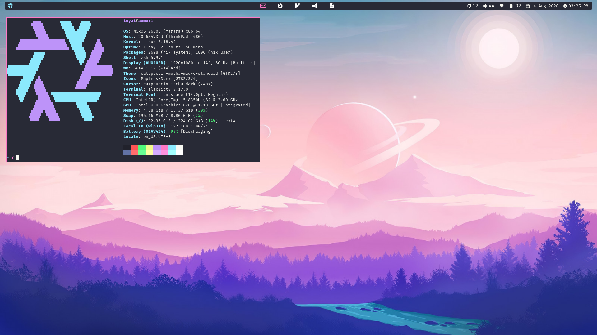
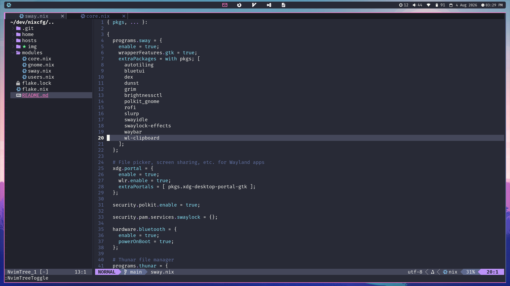

# nixcfg

This repository contains my NixOS and Home Manager configurations that build my systems.

## Screenshots

### Sway





## Setup

### NixOS

1. Install [Home Manager](https://nix-community.github.io/home-manager/installation/standalone.html).

```
nix-channel --add https://github.com/nix-community/home-manager/archive/release-26.05.tar.gz home-manager
nix-channel --update
nix-shell '<home-manager>' -A install
```

2. Create a new directory in `hosts/` with the hostname as the directory name.

3. Copy `hardware-configuration.nix` from `/etc/nixos/hardware-configuration.nix`:

```
cp /etc/nixos/hardware-configuration.nix ./hosts/<hostname>/hardware-configuration.nix
```

4. Populate `default.nix` and `home.nix` in `./hosts/<hostname>/`.

5. Populate `flake.nix` with a new NixOS configuration.

### Non-NixOS Systems

1. Run the installation script:

```
./scripts/install.sh
```

2. Install the packages via Nix and Home Manager:

```
home-manager switch --flake .#<config> --impure
```

> See the "Usage" section for available configurations

3. Add path to Nix's zsh to `/etc/shells`, which lists valid login shells:

```
echo /home/<username>/.nix-profile/bin/zsh | sudo tee -a /etc/shells
```

4. Change default login shell to Nix's zsh:

```
chsh -s /home/<username>/.nix-profile/bin/zsh
```

### Sway on Ubuntu with NVIDIA

Install Sway, its NVIDIA login entry, and the lock-screen clock:

```
./scripts/install-sway.sh
```

This requires sudo. Select **Sway (NVIDIA)** at the next login.

### Secrets

Secret environment variables (API keys, tokens) are kept out of the this repo. On login,
zsh sources `~/.config/secrets.env` if it exists.

Example:

```
export ANTHROPIC_API_KEY=...
export GITHUB_TOKEN=...
```

The file is optional per host. If it is absent, login proceeds normally.

## Usage

### Update Packages

```
nix flake update
```

### NixOS

```
sudo nixos-rebuild switch --flake .#<hostname>
```

### Non-NixOS

```
home-manager switch --flake .#<config> --impure
```

> Configuration options are `work-laptop`, `intel`, `nvidia`, or `jetson`.

### Zsh Shell

To start the configured shell, run:

```
nix run .#zsh
```

This starts Zsh with the custom shell configuration, Neovim, tmux, and CLI tools.

## Troubleshooting

### Enter tty from greeter

Press Ctrl+Alt+F3.
